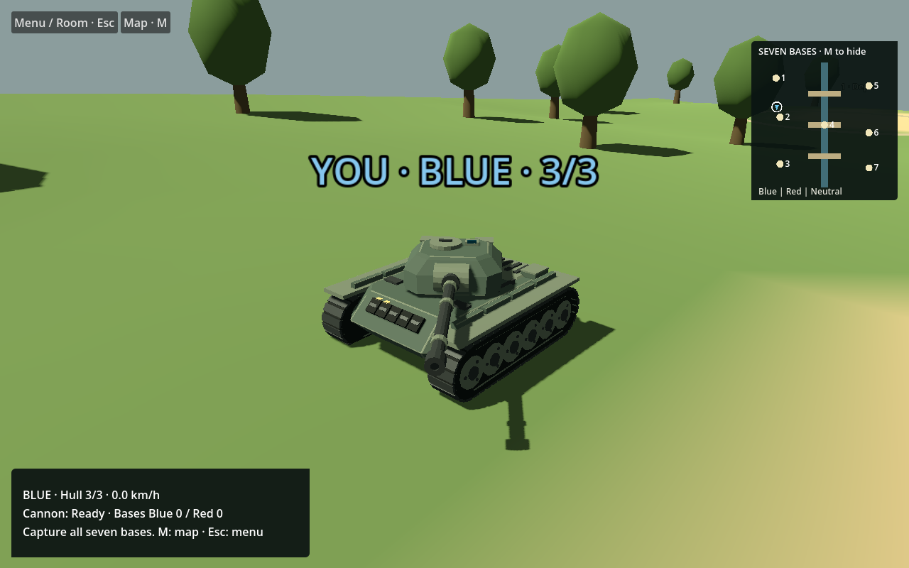
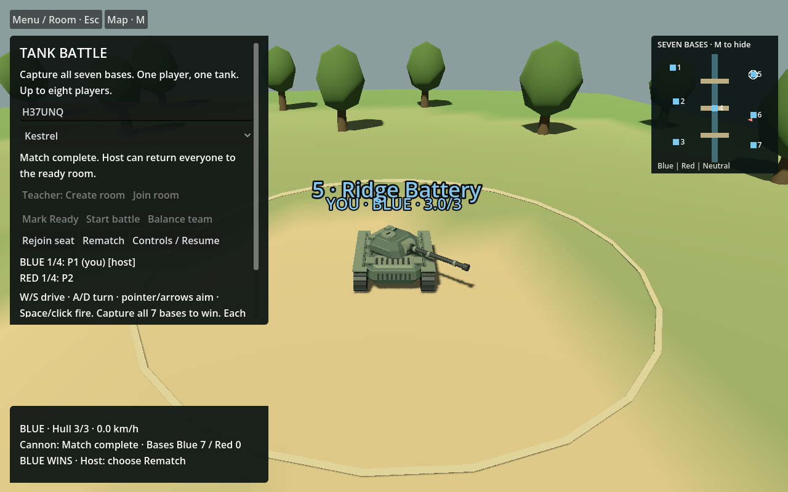

# Tank Battle · Godot

A browser-oriented, one-player-per-tank, seven-base team battle. Godot handles the scene, four original tank models, controls and room UI. Node/Rapier is the authoritative multiplayer server.

**Current source:** a curated snapshot of `e83cc89fa8f8803957f7e6d4f869e1e54fbcac8c`, 9 November 2026. This repository is source and documentation, **not a hosted student game**. Class/heat experiments are not included. See [current status](docs/CURRENT-STATUS.md) for the exact evidence limits.

Future development uses the verified GitHub-backed clone on `dev/student-pilot-20261109`; frozen recovery trees remain unchanged. The latest checkpoint adds evidence and reconciled requirements, not a new runtime export.

## Included

- Godot scenes, GDScript, map data, shader and four original runtime GLBs.
- Editable Blender sources and deterministic generator under `art/models` and `tools`.
- Preserved Node/Rapier authority and locked backend dependencies.
- Focused tests, development tools, updated project documentation and clearly labelled historical images.

Private Git history, credentials, raw operational logs, old recovery archives, dependencies, Godot cache and generated Web binaries are intentionally not published. See [source manifest](docs/source-manifest.json) and [assets and dependencies](docs/ASSETS-AND-DEPENDENCIES.md).

## Run locally

Prerequisites: Godot **4.8-beta2** with matching Web export templates, Compatibility rendering, no-thread Web export; Node.js and npm. This beta engine is the tested version, not a production-support claim. Blender 5.2.1 LTS is needed only for editing/regenerating models.

1. Install locked dependencies: `cd backend`, then `npm ci --ignore-scripts`, then return to the repository root.
2. Open `project.godot` in Godot and allow import. For the browser client, export the existing **Web** preset to `web/index.html`. Command-line equivalent: `godot --headless --path . --export-release Web web/index.html` (use your Godot executable name).
3. Start `node backend/run-godot-local.mjs` from the root.
4. Open `http://127.0.0.1:5218/godot/` in two browser tabs. Create a room in the first; enter its six-character code and Join in the second. Both mark Ready, then the host starts the battle.
5. Stop the owned server with Ctrl+C when finished.

The server binds IPv4 loopback only. That URL works on the server computer, not a classroom device or the public Internet. Static hosting alone cannot run the Node authority; opening the export without its adapter may show terrain without a playable match. Native Godot also requires the backend.

## Controls

W/S drive, A/D turn, pointer/arrows aim, Space/world click fire, M map, Escape/Menu controls. Capture all seven bases to win. Each hull has three hits and a four-second reload. Appearance selection does not change stats. Rejoin seat uses in-memory identity in the same page; refresh recovery is not promised.

## Documentation and checks

- [Current status and next milestone](docs/CURRENT-STATUS.md)
- [Architecture and protected hosting](docs/ARCHITECTURE.md)
- [Asset sources, licensing and image captions](docs/ASSETS-AND-DEPENDENCIES.md)
- [Verification and reproduction](docs/VERIFICATION.md)
- [Product requirements](PRD.md)

This screenshot is from predecessor `db26d685`, not a complete-match acceptance receipt for the current e83 snapshot. The exact e83 local lifecycle now passes in [the current receipt](docs/LIFECYCLE-20261109.json). A reachable protected pilot and school-device performance still require testing.
