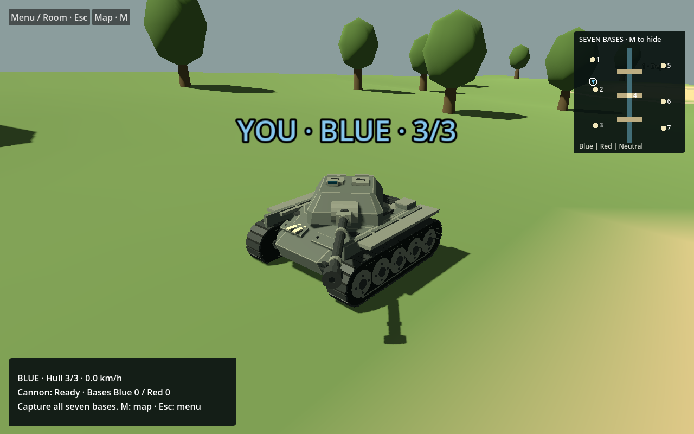
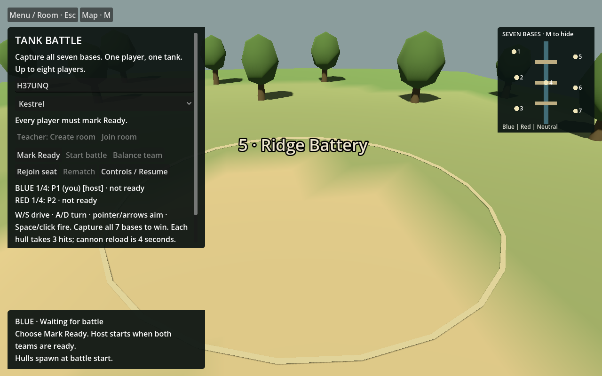

# Assets, dependencies and images

## Original model source

Kestrel, Bastion, Foundry and Palisade are fictional project-authored Blender geometry/materials. No museum images, downloaded tank meshes, markings, textures or paid asset packs are included. Editable sources and final GLBs are in `art/models/<name>/`; runtime copies are in `assets/models/`. Baseline models and the generator are retained for comparison. Open Blender files with automatic script execution disabled.

Preserve Hull, TurretYaw, BarrelPitch, Barrel and Muzzle hierarchy. Units are metres, +Z forward and +Y up. The authored rest muzzle is (0, 1.65, 4.05). The four appearances currently share prototype stats; they are not gameplay classes. Terrain/tree/bridge geometry and accepted-shot effects are project-authored procedural work.

The repository owner's existing MIT LICENSE is retained unchanged. Third-party dependencies retain their own licenses and are not vendored here:

- Three.js 0.186.1: MIT.
- @dimforge/rapier3d-compat 0.21.0: Apache-2.0.
- ws 8.22.0: MIT.
- Godot engine/export template: MIT, installed separately; retain its applicable notices when distributing engine binaries.
- Blender: separate GPL tool; not distributed in this repository.

`backend/package-lock.json` pins packages. `backend/ASSET_LICENSES.md` preserves historical provenance; references to old unbundled evidence are historical, not claims that those files ship here. No previously blocked/undownloaded donor asset was imported.

## Image captions

These are original in-game captures, inspected before inclusion. They contain anonymous game UI, not student identities, credentials or private desktop content.

- `images/kestrel-model.png`: historical native visual fixture showing the included Kestrel model; not a fresh multiplayer acceptance capture.
- `images/bastion-model.png`: historical native visual fixture showing the included Bastion model; same limitation.
- `images/historical-match-win.png`: predecessor db26d685 ordinary browser match after all seven bases were captured.
- `images/historical-rematch-ready.png`: same predecessor after actual Rematch, showing the waiting/readiness state.

The expired local test room code visible in two captures is not an access credential or live service. These historical pictures do not prove a complete current-e83 match, hosted access or target-device frame rate.

