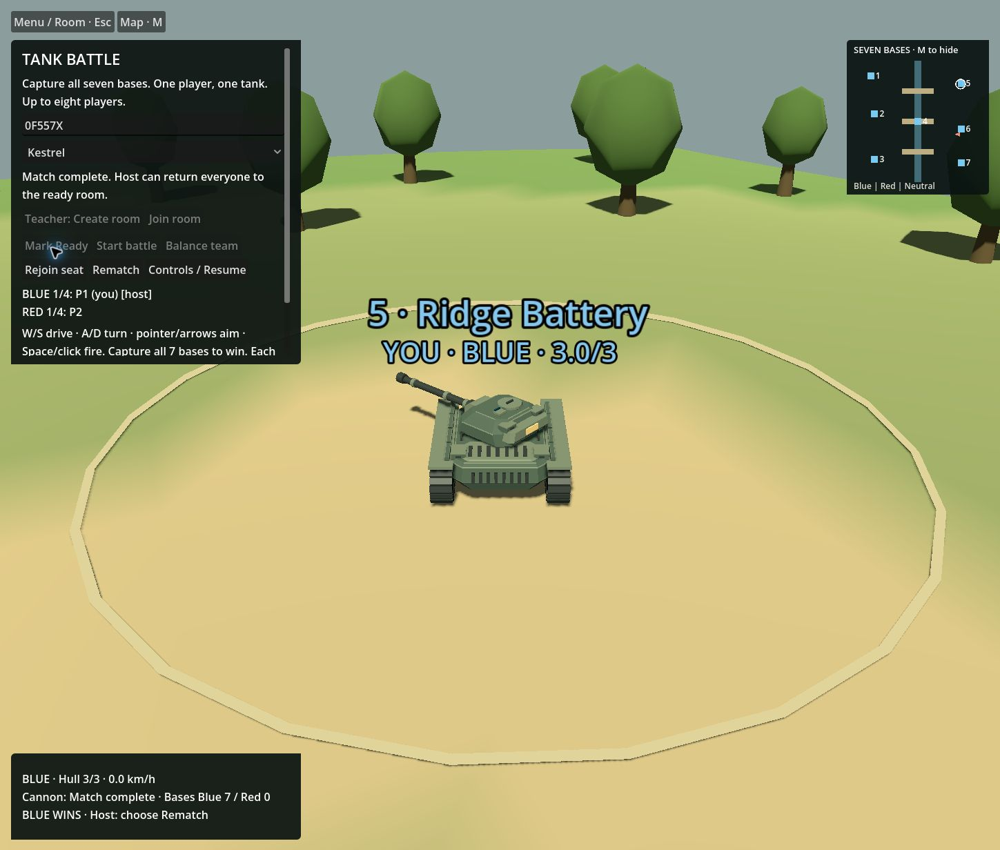
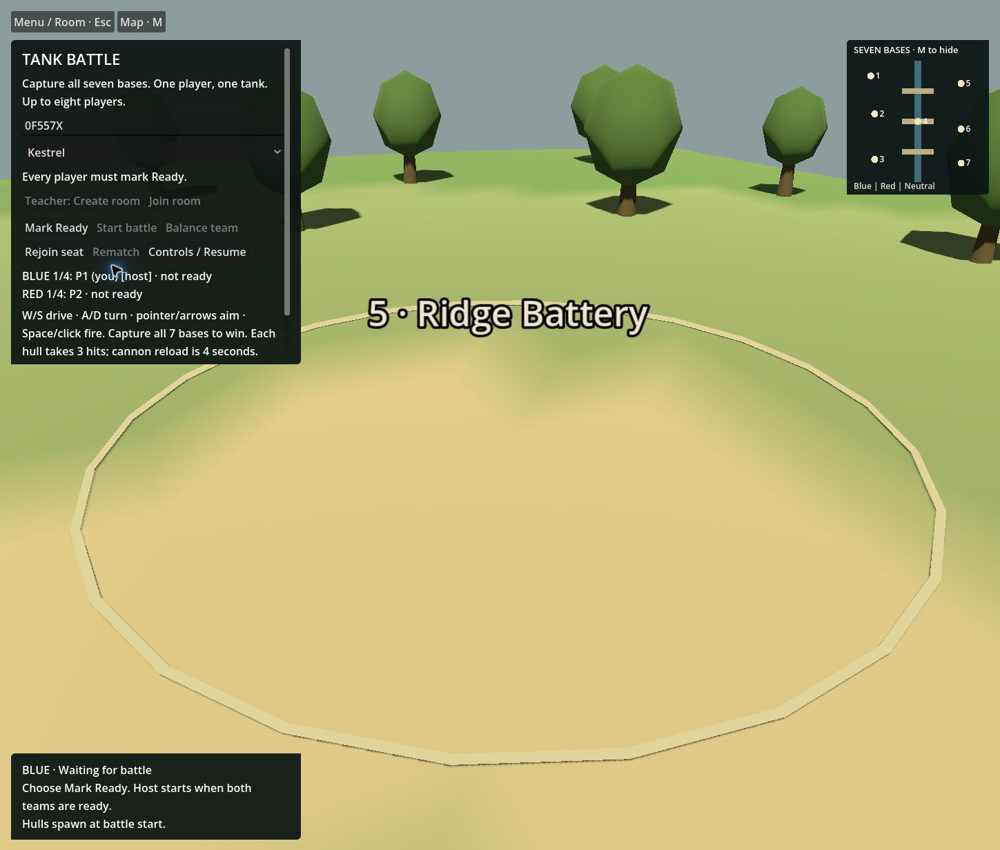

# Current status — 9 November 2026

## Current development source

Repository: https://github.com/DaytimeBlues/Tank . The verified GitHub-backed clone
on dev/student-pilot-20261109 is the future development worktree. Its starting
publication is 3290ff7ed4989f1e1c33cb53675e4dba139726e0. Frozen e83 and the older
private history are preserved separately; they have not been repointed or merged.
This checkpoint changes documentation/evidence only, not runtime code or balance.
The source manifest retains 133 unchanged baseline files and explicitly records the
PRD's appended reconciliation. The original publication receipt remains historical.

- Godot runtime baseline: e83cc89fa8f8803957f7e6d4f869e1e54fbcac8c.
- Node/Rapier authority lineage: 00c832da029bd46ca8bce4db3b56c4d6bca7cd13.
- Tested Web PCK: 2004736bee4f14a4cd93aee6b1ae0f2de66435ba79c91883d664b4fd62145034.
- Tested Web WASM: 17925d15afc88cdede21f09699dae9cf47a075e1b914877e0439b51278e9675d.

Generated Web binaries are not committed. A new export must be identified and tested
separately; do not assume it matches those hashes.

## Newly completed local evidence

[Current receipt](LIFECYCLE-20261109.json), 9 November 09:42–10:19 UTC: two real Chrome
tabs, ordinary controls, Create/Join/Ready/Start, driving/aim/fire, damage 3→2→1→0,
reload suppression, death/respawn, same-page rejoin, all seven captures and a shared
Blue 7 / Red 0 win. Host Rematch returned both clients to the correct waiting HUD,
neutral bases and cleared readiness. A new Ready/Start spawned both at full health;
second-round guest fire damaged the host, observed by both clients.

Captured console entries contained no warning/error. Both owned tabs and the bounded
loopback server were closed, and the endpoint refused connections. Read-only observation
had buffer eviction across some gaps; this is not a continuous network recording or video.
One operator drove both clients on one desktop. It proves the stated local journey,
not independent human play, refresh recovery, 4v4 or school performance.

Private provider recovery also completed: exact archive/bundle/manifest upload and
download hashes, fresh 648-file restore and history verification, clean source before
testing, matching Godot import and 54 scene / 212 wire-contact checks. Private provider
identifiers and history are intentionally not in this public repository.

## Historical evidence retained

Earlier e83 controls and wire-contact tests were bounded; one ended PARTIAL because
capture storage filled. Another host-only attempt stopped to avoid desktop interruption.
The new receipt closes their full local lifecycle gap; it does not rewrite those outcomes.
The four original gallery images remain labelled as historical native/predecessor fixtures.
Full predecessor db26d685 evidence used a different PCK and is not substituted for this run.

## Remaining gates and next slice

1. Independent source/evidence review passed: manifest, export bytes, screenshots and
   private restore receipts. It did not replay the browser journey; runtime sequence
   remains writer-observed tool evidence, with the limitations above.
2. Contact/camera fixture and one reference-matched tank/bridge-sector improvement,
   including portrait full-cannon framing. Follow the appended PRD's ordered plan.
3. Bounded accepted-event explosions and three separate map greyboxes, admitted through
   import, route, collision and measured rendering budgets. No full-map completion claimed.
4. Class/heat remains a separate older experiment requiring integration and balance tests.
5. A separately approved protected same-origin Node/WebSocket service is required for a
   reachable student pilot. Sites/GitHub static hosting alone is insufficient. Verify
   HTTPS/WSS, admission expiry/replay, owner-bound reconnect and provider restart there.
6. Actual school-device/network and 4v4 workload, human feel and sustained performance.

No live service was deployed. Terrain/effects remain prototype-quality. No offline AI,
native Godot authority, mobile touch support or final reference parity is claimed.
